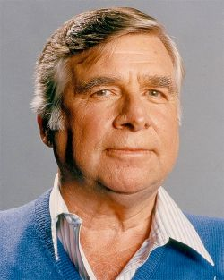

Sono passati 60 anni dalla prima serie.
Il mitico Gene Roddenberry creò una saga, fuori dagli schemi di quel tempo, che dura ancora adesso.

*Eccolo in tutto il suo riporto per chi non lo avesse mai visto.*

Ecco un infografia di tutte le serie e film, di Star Trek per fare un punto su tutto il materiale disponibile.  
[Star Trek Lista Serie e film](http://uran10.altervista.org/Varie/star_trek_atlante.html)

Visto l'evento ho pensato bene di *reperire* le ultime serie e guardamele, avevo visto le prime 3 serie di Discovery e la prima di Strange new world, ma non ero andato avanti.  
Devo dire che **Discovery** (vista tutta) sia una delle serie del *franchising* (come piace dire a molti) che ho fatto più fatica a finire. La serie è ben fatta, ma i personaggi e la storia non li ho amati, troppa azione inutile, troppi fattori emotivi, puntate non autoconclusive, salti temporali e il motore a spore che on ha senso.  
**Strange new world** (sono alla puntata 6 della 4° stagione) invece mi è piaciuto molto, anche se non so quanto hanno speso in parrucchiere per il capitato.  Mi sono piaciute anche le puntate *sperimentali*  in cui hanno mischiato la serie animata o quando era tutta in bianco e nero.\
**Starfleet Academy** (vista prima stagione) è una serie fatta per avvicinare i giovani alla serie, guardabile, guarderò le prossime puntate, carina, mi piace la preside, ma per il resto nulla di più.
In una lista personale metterei le serie in questo ordine di gradimento:  

1. The Next Generation
2. The Original Series *(l'avevo rivisto qualche anno fa e il peso dell'età si sente)*
3. Voyager
4. Deep Space Nine
5. Picard
6. Strange New Worlds
7. Enterprise
8. Lower Decks
9. Starfleet Academy
10. Prodigy
11. Discovery
12. The Animated Series *(ne ho viste poche, ma è invecchiato male)*

Short Treks non la inserisco nella lista, non le ho ancora viste, ma sono delle storie autoconlusive.
